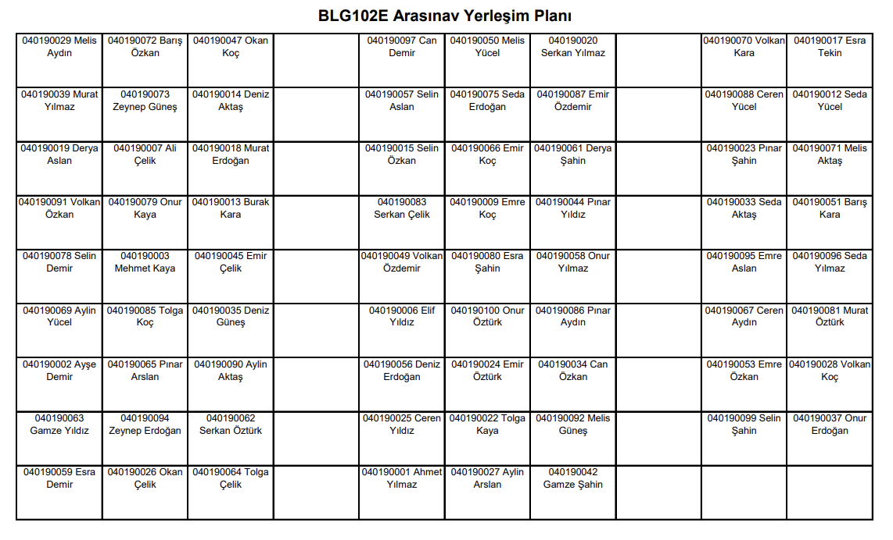

# Otomatik Oturma Planı Oluşturucu

Projenin amacı, oturma planı hazırlama işlemini **otomatikleştirmek** ve standartlaştırmaktır. Hazırlanan oturma planlarında öğrenci sadece imza atacağı için yoklama alma süreci de **hızlanacaktır**.

Program, verilen öğrenci listesini sınıflara otomatik olarak dağıtarak oturma planlarını Excel dosyası olarak oluşturur. Ardından PDF'e dönüştürerek Ninova'da paylaşılabilir hale getirir. Ek olarak tutanak sayfası eklenmiş halini de oluşturarak çıktı alınabilir hale getirir. Sınıf kapasiteleri ve oturma düzenleri önceden hazırlandığı için sadece öğrenci listesi ve sınıf seçimi yapılması gerekmektedir.

:construction: Şimdilik sadece Z-16 ve Z-17 sınıflarının oturma planları mevcuttur. Diğer sınıflar için template dosyalarının el birliği ile hazırlanması gerekmektedir.

:construction: Şimdilik MacOS'ta sadece Excel dosyasını oluşturmaktadır, PDF'e dönüştürme işleminin elle yapılması gerekmektedir.

## Hızlı Başlangıç

**1-** Ninovada planını hazırlamak istediğiniz sınıfın "Öğrenciler" sekmesindeki listeyi `ogrenci-listesi.txt` dosyasına kopyalayın.


**2-** `input.json` dosyasını aşağıdaki gibi düzenleyin.

```
{
    "exam_name": "BLG102E Arasınav Yerleşim Planı",         // Oturma planının başlığı
    "available_classrooms": ["Z-16", "Z-17"],               // Sınavın yapılacağı sınıflar
    "student_ids_file": "ogrenci-listesi.txt",
    "output_directory": "BLG102E-oturma-planları",
    ... 
}
```

**3-** `python seating_plan_generator.py` komutunu çalıştırarak planları **Excel** ve **PDF** dosyası olarak oluşturun. Örnek ekran görüntüsü (listelenen öğrenciler gerçek değildir):



## Kurulum

Python 3.8 ile test edilmiştir. Gerekli paketleri yüklemek için:

```bash
pip install -r requirements.txt
```

PDF'e dönüştürmek için Windows'ta **MS Office**, Linux'ta ise **LibreOffice** kurulu olmalıdır.  

## Detaylar

### Komut Satırı Arayüzü

```bash
python seating_plan_generator.py -c <config_file> -i <input_file>
```

Argümanlar:
- `-c, --config`: Yapılandırma JSON dosyasının yolu (Varsayılan: configuration.json)
- `-i, --input`: Girdi JSON dosyasının yolu (Varsayılan: input.json)

### Dosya Formatları

#### 1. `configuration.json` dosyası 
```json
{
    "classroom-capacities": {
        "Z-16": 70,
        "Z-17": 49,
        "Z-18": 54
    },
    "seat-mappings": {
        "Z-16": {
            "1": "C4",
            "2": "D4",
            "3": "E4"
        },
        "Z-17": {
            "1": "C4",
            "2": "D4",
            "3": "E4"
        }
    }
}
```

- `classroom-capacities`: Sınıf isimlerini ve kapasitelerini belirten alan
- `seat-mappings`: Template'e göre her sınıf için oturma düzenini belirten alan

#### 2. `input.json` dosyası
```json
{
    "exam_name": "BLG322E Arasınav Yerleşim Planı",
    "available_classrooms": ["Z-16", "Z-17"],
    "student_ids_file": "ogrenci-listesi.txt",
    "output_directory": "BLG322E-oturma-planlari",
    "cell_params": ["student_id", "name", "seat_number"]
}
```
- `exam_name`: Oturma planının başlığı
- `available_classrooms`: Kullanılacak sınıfların listesi (configuration.json'da belirtilmiş olmalıdır)
- `student_ids_file`: Öğrenci ID'lerini, adlarını ve mail adreslerini içeren metin dosyası
- `output_directory`: Çıktı dosyalarının kaydedileceği dizin
- `cell_params`: Oluşan pdf de hangi bilgilerin görünmesini istediğinizi belirtin. 

#### 3. Öğrenci ID'leri Dosyası (`input.json`'da `student_ids_file` alanı)
```text
150220722   Ahmet Yılmaz (yilmaza22)
150220724   Ayşe Kaya (kayaa22)
...
```
- Her satır, öğrenci ID, adı ve kısaltmasını içerir
- ID'ler ve adlar, tab veya boşluklarla ayrılır

#### 4. Excel Template Dosyaları
- Her sınıf için `Template_<sınıf-isim>.xlsx` formatında bir template dosyası olmalıdır. 
- Örnek: `Template_Z-16.xlsx`, `Template_Z-17.xlsx`
- Template dosyaları, sınıf düzenini içermelidir

## Programın Akışı

- Program, belirtilen configuration, input ve öğrenci listesi dosyalarını okur.
- Öğrenciler, her sınıf için belirtilen oturma düzenine göre Excel hücrelerine rastgele atanır.
- Çıktı dosyaları, `{exam_name}_{room}.xlsx` desenini kullanarak adlandırılır.

## Hata İşleme

Program, çeşitli hata durumlarını işler:
- Configuration/input dosyaları eksik veya geçersiz
- Girdi dosyasında bilinmeyen sınıflar
- Sınıflar için eksik oturma düzeni
- Boş oturma düzeni
- Yetersiz toplam kapasite
- Eksik template dosyaları
- Dosya izin sorunları

## Notlar

- Öğrenciler rastgele dağıtılır
- Template dosyalarının tam olarak `Template_ROOM.xlsx` olarak adlandırılması gerekir
- Uzun adlar, ilk ad + orta ilkler + soyad olarak yeniden biçimlendirilir
- Çıktı dosyaları, `{prefix}_{room}.xlsx` kalıbını kullanarak adlandırılır
- Çıktı dizinleri, eğer yoksa otomatik olarak oluşturulur

## Katkıda Bulunma

Eksik gördüğünüz veya daha iyi hale getirilebilecek bir şey varsa, lütfen PR açın. Lütfen yazım hataları, basit kod düzenlemeleri gibi şeyler için PR açmayın!

## Lisans 

Yayımlanan kodları izin almadan, kaynak göstermeden, özgürce okuyabilir, başkalarına okutabilir, kopyalayabilir, dağıtabilir, yayabilir, eleştirebilir, kendi etik ilkeleriniz doğrultusunda, çalabilir, talan edebilir, kısmen ya da tamamen sahiplenebilir, satabilir, değiştirerek ya da değiştirmeden tekrar yayımlayabilir, kötüleyebilir, lanetleyebilirsiniz.